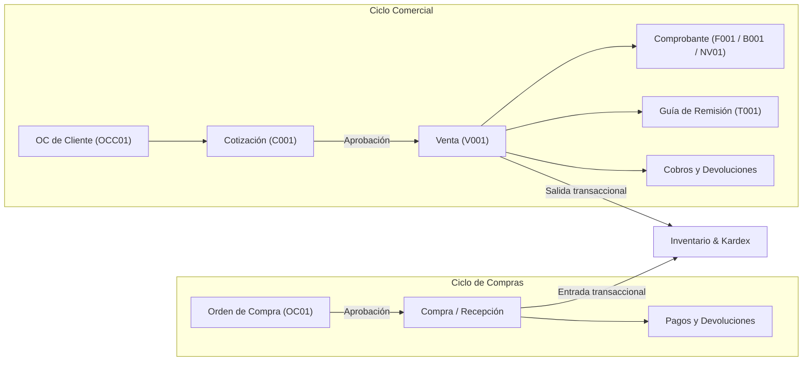

# Sistema ERP SaaS

Sistema web ERP integral desarrollado en **Laravel 13** para gestionar de extremo a extremo el ciclo comercial, compras a proveedores, inventario con kardex transaccional, emisión de comprobantes y guías en PDF, control financiero (cobros/pagos), administración de roles dinámicos y auditoría de operaciones.

<p align="left">
  
  
  
  
  
  
</p>

---

## Flujos Principales del Negocio



---

## Módulos y Funcionalidades

### Dashboard Ejecutivo
- Panel principal (`/dashboard`) con indicadores comerciales, saldos y gráficos interactivos con **Chart.js**.

### Catálogos y Maestros
- **Clientes (`/clientes`):** registro de clientes, datos fiscales y perfil tributario heredable en documentos.
- **Proveedores (`/proveedores`):** administración de proveedores asociados al catálogo.
- **Productos (`/productos`):** control de habilitación para compra/venta (`puede_venderse`, `puede_comprarse`), múltiples proveedores por producto y presentaciones de compra y venta configurables.

### Ciclo Comercial y Ventas
- **Órdenes de Compra de Clientes (`/ordenes-compra-cliente`):** recepción, seguimiento y adjunto de archivos de OC enviadas por clientes.
- **Cotizaciones (`/cotizaciones`):** serie correlativa `C001`, búsqueda rápida de productos, cálculo automático de márgenes, rentabilidad, comisiones, IGV y retenciones ajustables por documento, flujo de aprobación y generación de PDF corporativo.
- **Ventas (`/ventas`):** conversión desde cotización aprobada o venta directa (`V001`), descuento transaccional de stock, registro/anulación de cobros (`/ventas/{venta}/cobros`), devoluciones (`/ventas/{venta}/devoluciones`) y exportación en PDF.
- **Comprobantes y Guías (`/comprobantes`, `/guias-remision`):** emisión, vista previa/descarga PDF y anulación controlada de Facturas (`F001`), Boletas (`B001`), Notas de Venta (`NV01`) y Guías de Remisión (`T001`).

### Compras y Abastecimiento
- **Órdenes de Compra a Proveedores (`/ordenes-compra`):** emisión (`OC01`), aprobación, anulación y PDF.
- **Compras / Recepciones (`/compras`):** recepción vinculada a O/C aprobada o compra directa, ingreso automático al kardex, registro/anulación de pagos (`/compras/{compra}/pagos`) y devoluciones a proveedor (`/compras/{compra}/devoluciones`).

### Inventario y Kardex
- **Kardex (`/inventario/kardex`):** historial trazable de entradas, salidas y ajustes de existencias.
- **Ajustes de Inventario (`/inventario/ajuste`):** correcciones controladas por permiso específico (`accion:ajustar_inventario`) mediante `InventarioService` transaccional.

### Administración, Seguridad y Auditoría
- **Roles Dinámicos y Permisos (`/users`, `/roles`):** autorización por módulo (`modulo:*`), acciones críticas (`aprobar`, `anular`, `finanzas`, `ajustar_inventario`), excepciones por usuario (`user_modulo`) y protección inmutable de la cuenta SuperAdmin.
- **Configuración y Series (`/configuracion`, `/series-documentos`):** datos institucionales, logotipo, cuentas bancarias, tasas predeterminadas (IGV, retención, comisiones) y administración de series correlativas.
- **Auditoría (`/auditoria`):** trazabilidad automática de creaciones, ediciones y anulaciones en los modelos críticos del sistema.

---

## Stack Tecnológico

| Capa | Tecnologías |
|---|---|
| **Backend** | PHP `^8.3`, Laravel `^13.17`, Eloquent ORM |
| **Autenticación** | Laravel Breeze `^2.4` (stack Blade) |
| **Frontend** | Blade, Tailwind CSS, Alpine.js `^3.4`, Chart.js `^4.5`, Vite `^8.0` |
| **Reportes PDF** | `barryvdh/laravel-dompdf` `^3.1` |
| **Base de Datos** | MySQL 8.0+ / MariaDB (SQLite en memoria para pruebas) |
| **Pruebas y Calidad** | PHPUnit `^12.5`, Node Test Runner (`test:js`), Laravel Pint `^1.27` |

---

## Estructura del Proyecto

```text
sistema-erp-saas/
├── app/
│   ├── Http/Controllers/   # Controladores de maestros, ventas, compras, inventario y admin
│   ├── Http/Middleware/    # Control de acceso por módulo, acción y superadmin
│   ├── Models/             # Modelos Eloquent (documentos, detalles, kardex, roles, auditoría)
│   └── Services/           # Lógica de dominio (cálculo fiscal, inventario, finanzas, devoluciones, PDF)
├── database/
│   ├── migrations/         # Esquema relacional, índices y restricciones
│   └── seeders/            # Configuración inicial, módulos, roles y usuarios base
├── docs/                   # Guías técnicas de despliegue y operación
├── resources/              # Vistas Blade, CSS (Tailwind) y JS (Vite / Alpine / Chart.js)
├── routes/                 # Rutas web autenticadas y de autenticación
└── tests/                  # Pruebas Feature/Unit (PHPUnit) y tests JS de cálculos
```

---

## Instalación y Puesta en Marcha Local

### Requisitos previos
- **PHP** `>= 8.3` con extensiones estándar de Laravel (`pdo_mysql`, `mbstring`, `openssl`, `gd`, `xml`, `fileinfo`)
- **Composer** `>= 2.x`
- **Node.js** `>= 20.x` y **npm**
- **MySQL** `>= 8.0` (o MariaDB equivalente)

### Pasos de instalación

1. **Clonar el repositorio**
   ```bash
   git clone https://github.com/DrocuxDev/sistema-erp-saas.git
   cd sistema-erp-saas
   ```

2. **Instalar dependencias de backend y frontend**
   ```bash
   composer install
   npm install
   ```

3. **Configurar variables de entorno**

   Crea un archivo `.env` en la raíz del proyecto con tu configuración local:
   ```env
   APP_NAME="Sistema ERP SaaS"
   APP_ENV=local
   APP_KEY=
   APP_DEBUG=true
   APP_URL=http://127.0.0.1:8000

   DB_CONNECTION=mysql
   DB_HOST=127.0.0.1
   DB_PORT=3306
   DB_DATABASE=gestion_cotizaciones
   DB_USERNAME=root
   DB_PASSWORD=

   SESSION_DRIVER=database
   CACHE_STORE=database
   QUEUE_CONNECTION=database
   ```

4. **Generar la clave de aplicación, ejecutar migraciones y seeders**
   ```bash
   php artisan key:generate
   php artisan migrate --seed
   php artisan storage:link
   ```

5. **Compilar assets y levantar el entorno de desarrollo**
   ```bash
   npm run build
   php artisan serve
   ```
   O en modo desarrollo integrado con Vite:
   ```bash
   composer run dev
   ```

### Usuarios iniciales (entorno local)

Al ejecutar `php artisan db:seed` (`RolesAndModulosSeeder`), se crean los roles base (`SUPERADMIN`, `GERENCIA`, `ADMINISTRACION`, `VENTAS / COMERCIAL`, `SOPORTE TÉCNICO`, `TESORERIA`) y tres cuentas iniciales de prueba (contraseña por defecto: `password`):

| Rol | Usuario | Correo |
|---|---|---|
| SuperAdmin | `admin@jhardsystex` | `admin@jhardsystex.com` |
| Ventas / Comercial | `ventas@jhardsystex` | `ventas@jhardsystex.com` |
| Soporte Técnico | `soporte@jhardsystex` | `soporte@jhardsystex.com` |

> **Seguridad:** cambia las contraseñas por defecto inmediatamente antes de publicar en cualquier entorno productivo.

---

## Pruebas y Calidad de Código

```bash
# Suite de pruebas PHP (Feature y Unit sobre SQLite en memoria)
php artisan test

# Pruebas unitarias de cálculos en JavaScript
npm run test:js

# Verificación de estilo de código con Laravel Pint
vendor/bin/pint --test
```

---

## Documentación Adicional

- [Guía de despliegue en cPanel](DEPLOY-CPANEL.md)
- [Guía de despliegue para ingenieros](docs/GUIA-INGENIERO.md)
- [Plan de implementación del ERP](plan-implementacion-erp.md)
- [Informe de auditoría técnica](AUDITORIA.md)

---

## Licencia

Este proyecto se distribuye bajo la licencia **MIT**.
